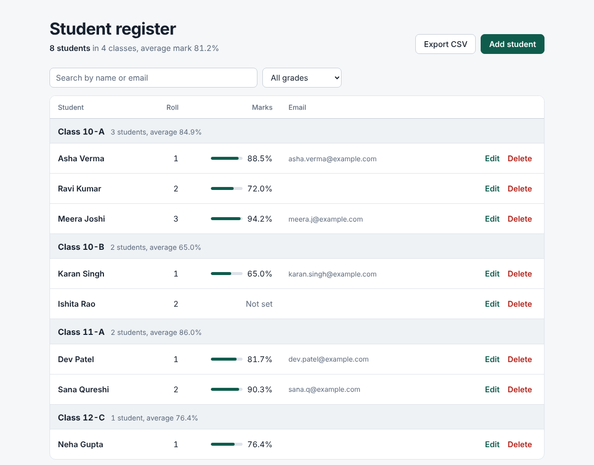
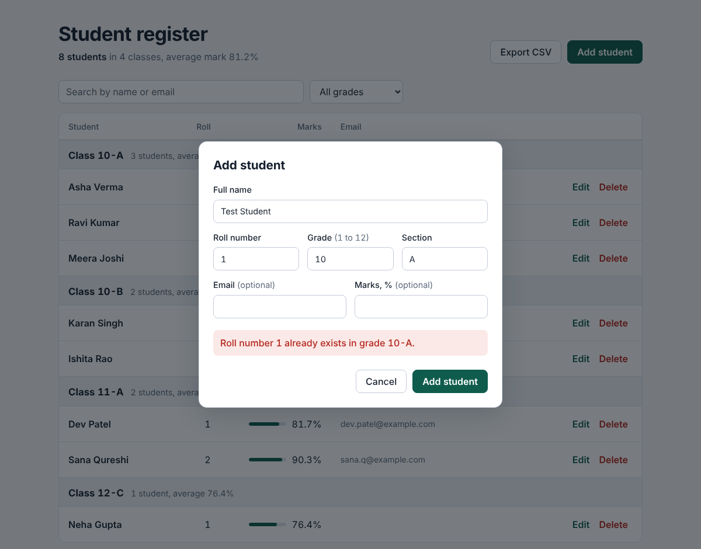
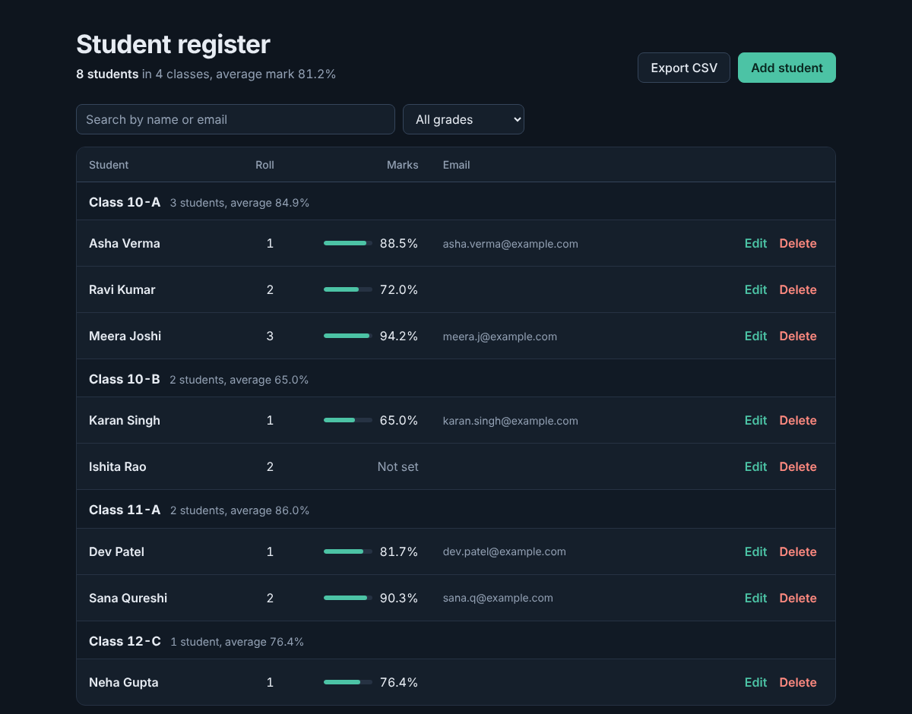

# Student Record Manager

A small command-line tool for managing school student records, backed by SQLite.

This started as a school project written in Python. This repository is a from-scratch rewrite of it, focused on structure, input validation and tests rather than new features.



*Screenshot uses made-up sample students.*

## Features

- Add, list, search, update and delete student records
- Records are stored in a local SQLite database, so they persist between runs
- Input validation on every field, with clear error messages
- Roll numbers are unique within a class and section
- Filter the list by grade and section
- Export all records to CSV
- Two interfaces over the same code: a command line and a browser interface
- The command line needs only the Python standard library. The browser interface needs Flask.

## Install

Requires Python 3.9 or newer.

```bash
git clone https://github.com/Ansh0976/student-record-manager.git
cd student-record-manager
pip install -e ".[web]"
```

`pip install -e .` installs the command line only. To run the tests as well: `pip install -e ".[dev]"`.

## Web interface

```bash
student-manager serve
```

Then open http://127.0.0.1:5000. Students are grouped by class, with each class showing its size and average mark. You can add, edit and delete students, search, filter by grade and export to CSV. It follows your system's light or dark setting and works on a phone-sized screen.

<p>
  
  
</p>

The server listens on this computer only (`127.0.0.1`) unless you pass `--host`. Use `--port` to change the port and `--db` to choose the database file.

## Command line usage

```bash
student-manager add --name "Asha Verma" --roll 1 --grade 10 --section A --email asha@example.com --percentage 88.5
student-manager add --name "Ravi Kumar" --roll 2 --grade 10 --section A --percentage 72
student-manager list
student-manager list --grade 10 --section A
student-manager search ravi
student-manager update 2 --percentage 75
student-manager delete 2            # asks for confirmation; add --yes to skip
student-manager export students.csv
```

Without installing, `python -m student_manager ...` works from the repository root if `src` is on `PYTHONPATH`.

By default the database is `students.db` in the current folder. Use `--db path/to/file.db` to choose another one.

Example output:

```
  ID  Name                     Class   Roll       %  Email
----------------------------------------------------------
   1  Asha Verma               10-A       1    88.5  asha@example.com
   2  Ravi Kumar               10-A       2    72.0
   3  Meera Joshi              10-B       1

3 student(s)
```

Errors are reported as a message with exit code 1, not a traceback:

```
Error: Roll number 1 already exists in grade 10-A.
Error: Grade must be between 1 and 12.
```

## Project structure

```
src/student_manager/
    validation.py   # one function per field; returns a cleaned value or raises ValidationError
    database.py     # StudentRepository: all SQL lives here
    export.py       # CSV export
    cli.py          # argparse commands; no SQL and no validation rules
    web.py          # Flask JSON API: /api/students, /api/export.csv
    static/index.html   # the browser interface (HTML, CSS and JavaScript, no build step)
tests/              # pytest suite
docs/               # screenshots
```

Validation, storage and the two interfaces are separate modules, so each can be tested without the others. The command line and the web API call the same `StudentRepository`, so they enforce identical rules. The database tests use an in-memory SQLite database and the web tests use a temporary file, so they never touch real data.

| Method | Path | Purpose |
| --- | --- | --- |
| GET | `/api/students?q=&grade=&section=` | List or search |
| POST | `/api/students` | Add (JSON body) |
| PUT | `/api/students/<id>` | Update any of the fields |
| DELETE | `/api/students/<id>` | Delete |
| GET | `/api/export.csv` | Download all records |

Errors return JSON like `{"error": "..."}` with 400 for invalid input, 404 for an unknown id and 409 for a duplicate roll number.

## Design decisions

- **Parameterised SQL.** Every query passes values through `?` placeholders instead of building strings, so input like `' OR '1'='1` is treated as plain text. There is a test for this.
- **Whitelisted columns on update.** The `UPDATE` statement builds its column list from a fixed dictionary of known fields, never from user input.
- **Constraints in the database too.** The schema has `CHECK` constraints and a `UNIQUE (grade, section, roll_number)` rule, so bad data is rejected even if the Python validation is bypassed.
- **LIKE wildcards escaped in search.** Searching for `%` or `_` matches those characters literally instead of matching everything.
- **CSV formula injection.** Spreadsheet programs run cells that start with `=`, `+`, `-` or `@` as formulas. The exporter prefixes such cells with a quote.
- **No HTML injection in the browser interface.** The page builds its table with `textContent`, never `innerHTML`, so stored text is always shown as text. Names are also restricted to letters and a few punctuation marks.
- **JSON-only API with a size limit.** Write requests must be JSON (a plain HTML form from another site cannot send that without permission) and bodies over 64 KB are rejected.
- **A local server by default.** `serve` binds to `127.0.0.1`, so other devices on the network cannot reach it.
- **Grouping is the interface.** A school register is organised by class, so the table is grouped the same way, with the count and average shown on each class heading. Everything else is kept plain.

## Testing

```bash
pytest
```

The suite covers validation edge cases, duplicate handling, update and delete behaviour, persistence on disk, CSV output and the CLI end to end.

## Limitations

- Single-user. SQLite handles one writer at a time and there is no login or access control.
- No authentication, so anyone who can run the tool, or reach the web server, can change the data. Do not expose `serve` to the internet.
- The web server is Flask's built-in development server. It is fine for local use but is not meant for production.
- The page loads the Schibsted Grotesk font from Google Fonts. Offline, it falls back to the system font.
- The browser interface has been tested in headless Chrome, not across other browsers.
- No pagination: `list` and the web table show every matching record.
- Names accept letters, spaces, `'`, `-` and `.` only, which may reject some real names.
- Percentage is a single number per student, not a per-subject marks model.
- There is no schema migration. Changing the table would need a migration step.

## Possible improvements

- Per-subject marks in a separate table, with computed averages and ranks
- CSV import with row-level error reports
- Login and per-teacher access for the web interface
- Sorting by column in the web table

## Licence

MIT. See [LICENSE](LICENSE).
